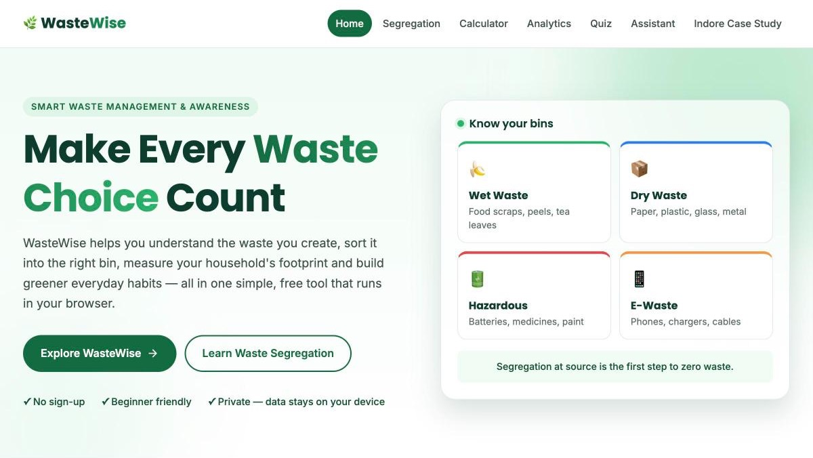

<div align="center">

# 🌿 WasteWise

### Smart Waste Management & Awareness System

**Learn to segregate, measure and reduce your household waste — one smart habit at a time.**




</div>

---

## 📖 About the Project

**WasteWise** is a responsive website that helps Indian households manage their waste responsibly.
It explains which bin each item belongs in, estimates how much waste a household produces, turns
those numbers into simple charts, tests waste-management knowledge through a quiz, and shows how
Indore became one of India's cleanest cities.

Everything runs directly in the browser: no sign-up, no server and no tracking. Any data you enter
stays on your own device.

---

## 📑 Table of Contents

- [Features](#-features)
- [Tech Stack](#-tech-stack)
- [Getting Started](#-getting-started)
- [Project Structure](#-project-structure)
- [How It Works](#-how-it-works)
- [Data & Privacy](#-data--privacy)
- [Accessibility & Quality](#-accessibility--quality)
- [Case Study Sources](#-case-study-sources)
- [Credits](#-credits)
- [Limitations](#-limitations)

---

## ✨ Features

| | Page | Description |
|:-:|---|---|
| 🏠 | **Home Dashboard** | Introduction to WasteWise, why segregation matters, quick links to every tool and a four-step guide to better habits. |
| ♻️ | **Waste Segregation Guide** | Six waste categories and 48 everyday items, with live search, category filters and disposal advice. |
| 🧮 | **Waste Calculator** | Enter your daily waste in six categories to get daily, weekly and monthly totals and a category-wise breakdown. |
| 📊 | **Waste Analytics** | A donut chart, a bar chart and rule-based insights generated from your latest calculation. |
| 🧠 | **Awareness Quiz** | 15 multiple-choice questions with a progress bar, scoring, result levels and explanations for every answer. |
| 💬 | **Smart Disposal Assistant** | A rule-based (not AI) search that finds the closest matching item and shows how to dispose of it, with warnings and tips. |
| 🏙️ | **Indore Case Study** | How Indore manages its waste: a timeline, a six-step workflow, sourced evidence, challenges and lessons for other cities. |

---

## 🛠️ Tech Stack

| Area | Used |
|---|---|
| Structure | HTML5 |
| Styling | CSS3 (custom properties, Flexbox, Grid, media queries) |
| Logic | Vanilla JavaScript (no libraries) |
| Charts | Hand-drawn SVG |
| Storage | Browser `localStorage` |
| Fonts | Poppins & Inter (Google Fonts) |

No frameworks, backend, database, paid APIs or AI models are used.

---

## 🚀 Getting Started

**Option 1 — VS Code (recommended)**

1. Open the `WasteWise` folder in VS Code.
2. Install the **Live Server** extension.
3. Right-click `index.html` and choose **Open with Live Server**.

**Option 2 — Directly in a browser**

Double-click `index.html` to open it in Chrome, Edge, Firefox or Safari.

---

## 📁 Project Structure

```
WasteWise/
├── index.html              Home Dashboard
├── segregation.html        Waste Segregation Guide
├── calculator.html         Waste Calculator
├── analytics.html          Waste Analytics
├── quiz.html               Awareness Quiz
├── assistant.html          Smart Disposal Assistant
├── case-study.html         Indore Case Study
│
├── css/
│   ├── style.css           Shared design system (colours, buttons, cards, navbar, footer)
│   ├── responsive.css      Shared tablet and mobile layouts
│   └── pages/              One stylesheet per page
│
├── js/
│   ├── main.js             Mobile menu, active link and scroll animations
│   ├── storage.js          Save / load helpers for localStorage
│   ├── data/
│   │   ├── waste-items.js      6 categories and 48 household items
│   │   └── quiz-questions.js   15 quiz questions
│   └── <page>.js           Logic for each page
│
└── assets/
    ├── favicon.svg
    ├── images/             Case-study photo
    └── screenshots/        README screenshot
```

---

## ⚙️ How It Works

- **One shared dataset:** `waste-items.js` powers the Segregation Guide, the Disposal Assistant, the Calculator and Analytics, so advice is consistent across pages.
- **Calculator → Analytics:** the Calculator saves each valid result; Analytics reads the latest result and draws the charts.
- **Rule-based insights and search:** fixed `if` rules and keyword matching. No AI is involved.
- **Formulas:**
  - Daily total = sum of the six categories
  - Weekly = daily × 7
  - Monthly = daily × 30
  - Category % = category ÷ daily total × 100

---

## 🔒 Data & Privacy

Nothing is sent to any server. Two keys are stored in the browser:

| Key | Saved by | Contains |
|---|---|---|
| `wasteWiseCalculatorData` | Calculator | Latest calculation and up to 30 previous ones |
| `wasteWiseQuizResult` | Quiz | Latest score, result level and best score |

Clearing your browser data removes them.

---

## ♿ Accessibility & Quality

- ✅ **HTML:** valid on every page (checked with `html-validate`).
- ✅ **Colour contrast:** text meets WCAG AA (at least 4.5:1).
- ✅ **Keyboard:** "Skip to main content" link, visible focus outlines, Escape closes the mobile menu, and the quiz has keyboard shortcuts.
- ✅ **Screen readers:** labelled form fields, live result counts, and text descriptions for charts and images.
- ✅ **Reduced motion:** animations are reduced when the device's "reduce motion" setting is on.
- ✅ **Responsive:** layouts for desktop, tablet and mobile, with no sideways scrolling.

---

## 📚 Case Study Sources

1. [Indore Municipal Corporation — Waste Management](https://imcindore.mp.gov.in/waste-management)
2. [Indore Smart City — Solid Waste Management](https://www.smartcityindore.org/solid-waste/)
3. [NITI Aayog & CSE — *Waste-Wise Cities* (2021)](https://www.niti.gov.in/node/362)
4. [CAG — Performance Audit on Waste Management in Urban Local Bodies, Madhya Pradesh (Report No. 2 of 2024)](https://www.cag.gov.in/en/audit-report/details/121262)
5. [Global Methane Initiative / U.S. EPA — Indore case study](https://gmidev.org/web/how-indias-cleanest-city-reduces-methane-emissions-municipal-solid-waste)

---

## 🙏 Credits

- **Photo:** "Door-to-door Garbage Collection Vans in Indore - Under Swachh Bharat Abhiyan" by TheodoreIndiana, [Wikimedia Commons](https://commons.wikimedia.org/wiki/File:Door-to-door_Garbage_Collection_Vans_in_Indore_-_Under_Swachh_Bharat_Abhiyan.jpg), licensed [CC BY-SA 3.0](https://creativecommons.org/licenses/by-sa/3.0/).
- **Fonts:** [Poppins](https://fonts.google.com/specimen/Poppins) and [Inter](https://fonts.google.com/specimen/Inter), SIL Open Font License.

---

## ⚠️ Limitations

- The Guide and the Assistant cover the 48 items in the dataset and do not correct spelling mistakes.
- Calculator results are estimates based on the numbers entered.
- Saved data stays in one browser on one device.
- Waste rules and bin colours vary between cities, so always follow your local municipal guidelines.

---

<div align="center">

**Reduce · Reuse · Recycle** 🌱

</div>
